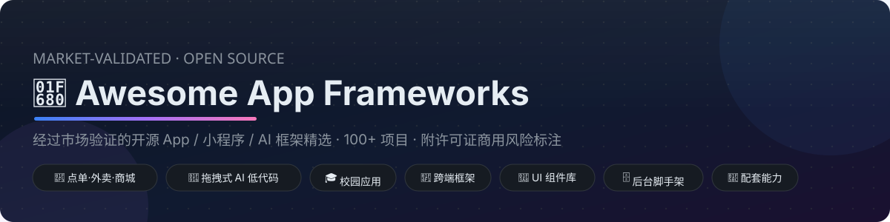
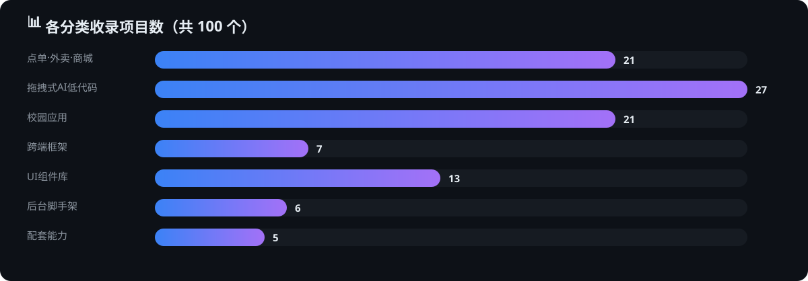
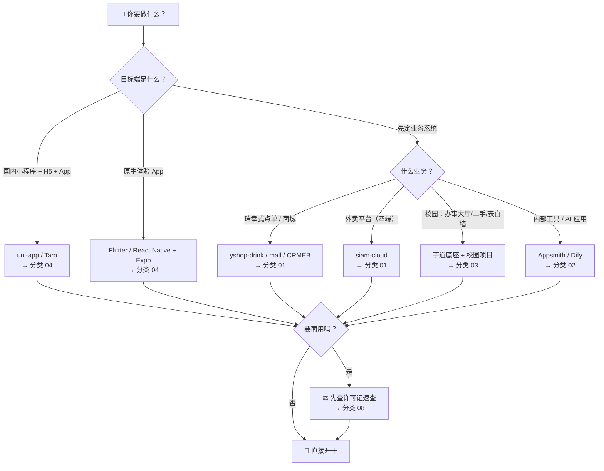

# 🚀 Awesome App Frameworks · 经过市场验证的开源 App / 小程序 / AI 框架精选

  

> 像瑞幸点单、交我办校园服务这样的产品背后，都有一套"被市场反复验证过"的技术底座。
>
> 本仓库系统性收集并分类整理这些**成熟开源项目**：完整业务系统、拖拽式 AI 辅助开发平台、校园应用框架、跨端框架、UI 组件库与配套能力，帮助你在选型时"抄对作业"。
>
> 🖥️ **不想看 Markdown？** [点这里打开可搜索、可筛选的在线总览页 →](https://jensen-yao.github.io/awesome-app-frameworks/)

## 🎯 收录原则（市场验证优先）

- ✅ **大厂出品或有大量真实商业案例**（如腾讯 TDesign、京东 Taro、有赞 Vant）
- ✅ **社区规模与活跃度**（Star 数、Issue 响应速度、发版频率）
- ✅ **文档与生态完备**（教程、二开案例、插件生态）
- ✅ **维护状态健康**（非归档、非长期停更，停更会明确标注）
- ⚠️ **标注许可证与商用注意事项**：AGPL / 修改版 Apache / Fair-code 等特殊许可会明确提示

## 📚 目录（收录 100+ 项目，数据核实于 2026-10-12）

| # | 分类 | 覆盖内容 |
|---|---|---|
| 01 | [点单 / 外卖 / 商城](docs/01-ordering-commerce.md) | 瑞幸式点单 App 拆解、外卖平台（用户端/商家端/骑手端）、完整开源商城（mall 84.9k / litemall / CRMEB）、商城低代码搭建 |
| 02 | [拖拽式 AI 辅助开发](docs/02-dragdrop-ai-lowcode.md) | AI 工作流平台（Dify 158k / Coze / n8n）、低代码应用构建器（Appsmith / ToolJet）、国内表单页面设计器（amis / formily）、AI 编程代理 |
| 03 | [校园应用](docs/03-campus.md) | 交我办式办事大厅底座、校园二手交易、表白墙/社区、跑腿代取、在线考试、复旦 DanXi 校园 App |
| 04 | [跨端开发框架](docs/04-cross-platform.md) | uni-app / Taro / Flutter / React Native / Expo / Compose Multiplatform |
| 05 | [小程序 & 移动端 UI 组件库](docs/05-ui-libraries.md) | 大厂出品、市场验证的 UI 库（Vant / TDesign / NutUI / WeUI / Element Plus…） |
| 06 | [后台管理与脚手架](docs/06-admin-scaffold.md) | vue-vben-admin / Ant Design Pro / 芋道 / JeecgBoot / gin-vue-admin / Sa-Token |
| 07 | [配套能力](docs/07-essential-services.md) | 微信生态 SDK（WxJava 33.2k）/ 聚合支付（jeepay）/ IM（OpenIM）/ 消息推送（novu） |
| 附 | [开源许可证商用速查](docs/08-license-guide.md) | MIT / Apache-2.0 / AGPL / 修改版许可 / Fair-code 对商用的影响 |

  

## ⚡ 一分钟速览（每类最值得先看的）

| 你想做 | 首选开源方案 |
|---|---|
| 瑞幸式点单小程序 | [yshop-drink](https://github.com/guchengwuyue/yshop-drink)（扫码点单/多门店/SaaS）+ [vant-weapp](https://github.com/youzan/vant-weapp) 换皮 |
| 完整电商商城 | [mall](https://github.com/macrozheng/mall)（84.9k）/ [litemall](https://github.com/linlinjava/litemall)（MIT 干净）/ [CRMEB](https://github.com/crmeb/CRMEB)（营销玩法全） |
| 外卖平台四端 | [siam-cloud](https://github.com/siam1026/siam-cloud)（用户/商家/骑手/后台） |
| 拖拽搭 AI 应用 | [Dify](https://github.com/langgenius/dify)（生态最大）/ [Coze Studio](https://github.com/coze-dev/coze-studio)（字节，Apache-2.0） |
| 拖拽搭内部工具 | [Appsmith](https://github.com/appsmithorg/appsmith)（开源 Retool） |
| 校园办事大厅 | [芋道 ruoyi-vue-pro](https://github.com/YunaiV/ruoyi-vue-pro) + [Sa-Token](https://github.com/dromara/Sa-Token)（SSO 统一认证） |
| 校园二手平台 | [Used-Trading-Platform](https://github.com/wsk1103/Used-Trading-Platform)（MIT） |
| 多端小程序 | [uni-app](https://github.com/dcloudio/uni-app)（Vue）/ [Taro](https://github.com/NervJS/taro)（React，京东出品） |
| 微信后端对接 | [WxJava](https://github.com/binarywang/WxJava)（33.2k，微信全家桶 SDK） |

## 🧭 如何选型（决策路径）

1. **先想清楚你要做什么端**
   - 微信小程序 + H5 + App 多端覆盖 → 跨端框架（uni-app / Taro，见分类 04）
   - 追求原生体验与复杂动效 → Flutter / React Native
2. **再看业务完整度**
   - 想要"开箱即用的完整点单/商城系统" → 分类 01 的整套方案（litemall、mall4j、CRMEB 等）
   - 只想要"点单界面 + 自己写后端" → 分类 05 的 UI 组件库 + 分类 01 的参考项目
   - 想快速搭建内部工具 / AI 应用 / 自动化流程 → 分类 02 的低代码平台
   - 做校园项目（二手、表白墙、办事大厅）→ 分类 03
   - 支付 / 聊天 / 推送等横向能力 → 分类 07
3. **最后查许可证**：任何商用动作前，先读[许可证速查](docs/08-license-guide.md)，再看目标仓库的 LICENSE 原文

## 📅 数据说明

- 所有 Star 数与维护状态统计于 **2026-10-12**，会随迭代更新
- 本仓库只做索引与点评，不对上游项目的可用性、安全性作担保
- 欢迎通过 Issue / PR 推荐新项目或纠错，见[贡献指南](CONTRIBUTING.md)

## 📄 License

本仓库内容以 [MIT](LICENSE) 发布；各被收录项目以其自身许可证为准。
